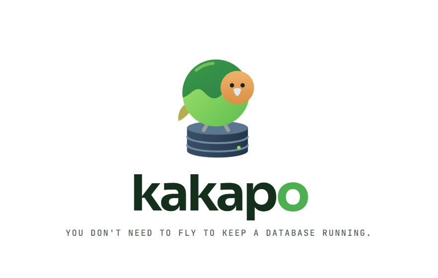

  

Many database administration tools already exist for monitoring, profiling and maintenance. However, they often require installations, configuration and advanced technical knowledge to get started.

**Kakapo is different.**

Kakapo can be dropped into almost any SQL Server environment and immediately start identifying potential issues. It is one Windows program: nothing to install, nothing to configure first.

It's useful for quick assessments, ongoing monitoring, or as a tool to help you act on the findings.

Kakapo maintains a small database of its own for the information it needs, while all scheduling, maintenance and upkeep are configured and managed directly through SQL Server.

Our approach is to identify and prioritise the small things that make a difference: low-risk improvements that help you get your SQL Server environment properly configured and aligned with best practices, delivering immediate value.

You can also use Kakapo to explore performance tuning and database design. But the real focus is simplicity: providing guidance, hand-holding and practical recommendations to make what is otherwise a complicated task more accessible.

**Less complexity. Better visibility. A healthier SQL Server.**

## How it is built

Kakapo is designed and developed by engineers, from best practices and patterns that have proven themselves in the field: Microsoft's own documentation, the open-source toolkits the SQL Server community relies on, and the checks our engineers have used on client servers for years.

Every recommendation rests on a fact and a source. Each check has its rule, its thresholds, why it matters, what to do and how to confirm it worked. A number without a source does not ship.

## What it does

- **Health checks.** The server and each database: backups, integrity checks, server and database settings, Query Store, alerts and more. Each finding is a plain sentence first, with the numbers behind it.
- **A maintenance plan.** Backups, integrity checks, statistics and optional index work, scheduled in SQL Server Agent, or by kakapo's own procedure where there is no Agent (SQL Server Express).
- **Performance.** The slowest and most expensive queries, blocking and deadlocks, memory, and a tuning report that answers "is it better or worse than before?".
- **Indexes.** Fragmentation, missing indexes on foreign keys, heaps, and index work you can run or schedule.
- **What changed?** Every change to a server's settings, who made it and when, with kakapo's own log of what it did, before and after.

## Safe by design

- Kakapo only reads, until you ask it to change something.
- Every fix shows the exact T-SQL it will run and how to undo it. It runs only when you confirm, reads the result back and records the change.
- Nothing is installed on a server unless you apply a fix that installs it, such as the maintenance procedure or Ola Hallengren's IndexOptimize.
- SQL login passwords are kept in Windows Credential Manager, never in kakapo's own database.

## Getting started

1. Download `kakapo.exe` (or the zip) from [Releases](https://github.com/fdtaljaard/kakapo/releases).
2. Double-click it. Kakapo opens in its own window; the first start can take a minute while antivirus scans it.
3. Add a SQL Server, test the connection and save. Kakapo starts reading straight away.

Kakapo runs on Windows x64 and opens its window in Microsoft Edge. Its data stays in `kakapo.duckdb` beside the exe. To build it from source, see [sc/readme.md](sc/readme.md).

## Credits

Kakapo stands on the work of people who have shared what they know about SQL Server. Thank you.

**The knowledge**

| Source | What kakapo uses |
|---|---|
| [Erik Darling, DarlingData](https://github.com/erikdarlingdata/DarlingData) | Checks and thresholds, each marked in the code: wait categories, Query Store noise, trace flags, memory and CPU pressure, the system_health and blocking readers, SQL Agent alerts. |
| [Erik Darling, Performance Monitor](https://github.com/erikdarlingdata/PerformanceMonitor) | The shape: one portable program, nothing installed on the server. |
| [Ola Hallengren, SQL Server Maintenance Solution](https://github.com/olahallengren/sql-server-maintenance-solution) | `IndexOptimize`, `CommandExecute` and `CommandLog`, shipped unchanged and installed only on request, and his maintenance guidance. |
| [Brent Ozar Unlimited, SQL Server First Responder Kit](https://github.com/BrentOzarULTD/SQL-Server-First-Responder-Kit) | A reference for checks (`sp_Blitz`, `sp_BlitzIndex`), the SQL Server build list, and the 50% and 80% index fragmentation thresholds. |
| [Microsoft, SQL Server documentation](https://github.com/MicrosoftDocs/sql-docs) | The first source for every setting, default and recommendation. |
| [Paul Randal, SQLskills](https://www.sqlskills.com/help/waits/) | The wait types library and the guidance on how often to check integrity. |

**The building blocks**

| Project | Used for |
|---|---|
| [Go](https://github.com/golang/go) | The program itself |
| [DuckDB](https://github.com/duckdb/duckdb) and [duckdb-go](https://github.com/duckdb/duckdb-go) | Kakapo's own database |
| [go-mssqldb](https://github.com/microsoft/go-mssqldb) | Connecting to SQL Server |
| [wincred](https://github.com/danieljoos/wincred) | Windows Credential Manager |
| [React](https://github.com/react/react), [Vite](https://github.com/vitejs/vite) and [Tailwind CSS](https://github.com/tailwindlabs/tailwindcss) | The user interface |
| [shadcn/ui](https://github.com/shadcn-ui/ui), [Radix UI](https://github.com/radix-ui/primitives) and [Lucide](https://github.com/lucide-icons/lucide) | Components and icons |
| [Geist](https://github.com/vercel/geist-font) | The typeface |

Licences and the exact fragments taken are listed in [sc/THIRD_PARTY_NOTICES.md](sc/THIRD_PARTY_NOTICES.md).
